# Motocross Dekor: Passform nach Bike

[English](README.md) | [Deutsch](README.de.md) | [Français](README.fr.md) | [Italiano](README.it.md) | [Polski](README.pl.md) | [日本語](README.ja.md)

Welche Dirt Bikes dieselben Plastikteile haben und deshalb dasselbe Dekor-Kit fahren können. Passform für 175 Modelljahre (76 Modelle, 11 Marken), gruppiert unter 17 Referenz-Bikes: Motocross, Enduro und Elektro.

| | | | |
|:---:|:---:|:---:|:---:|
| 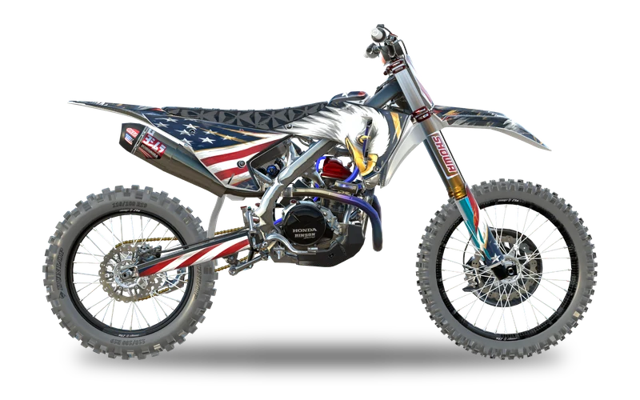 Honda CRF450R | 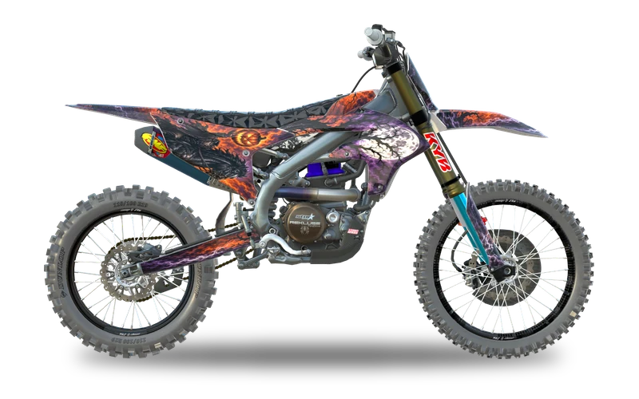 Yamaha YZ450F | 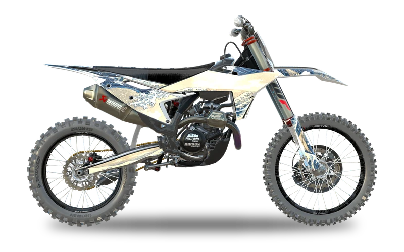 KTM 450 SX-F | 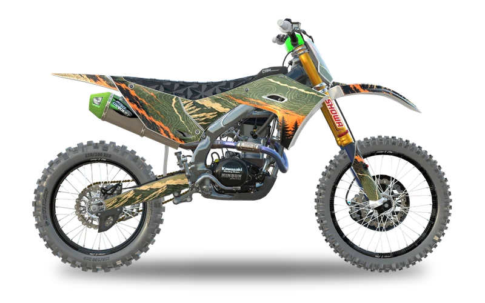 Kawasaki KX450 |
| 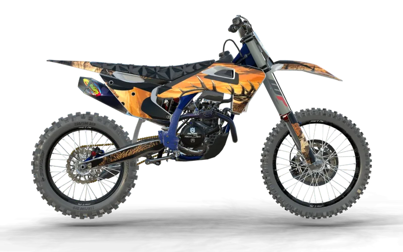 Husqvarna FC 450 | 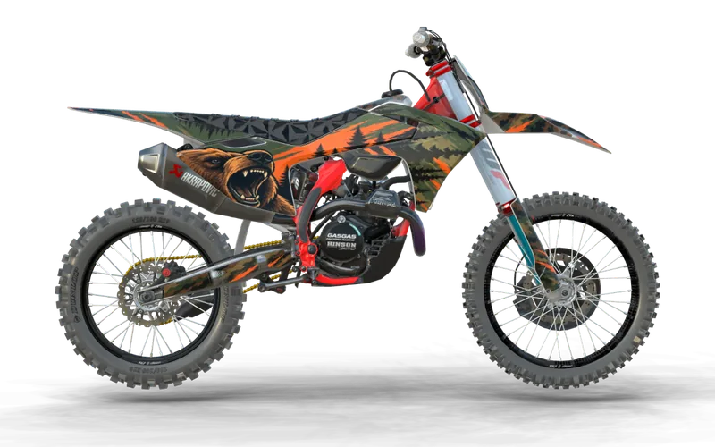 GasGas MC 450F | 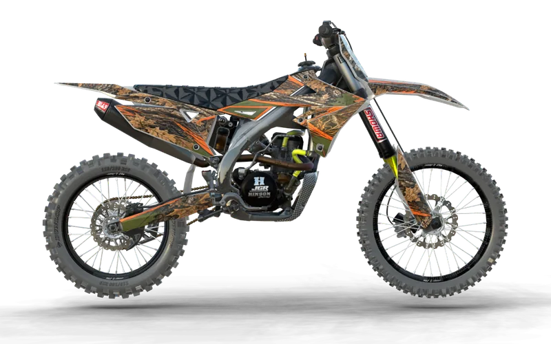 Suzuki RM-Z450 | 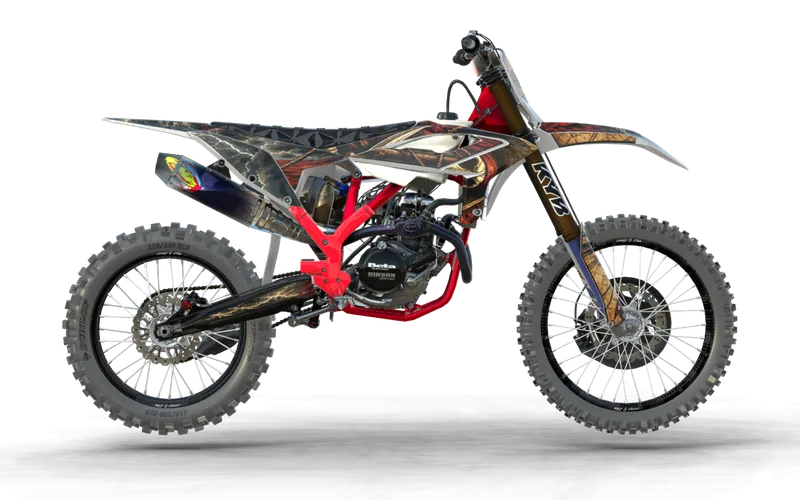 Beta 450 RX |
| 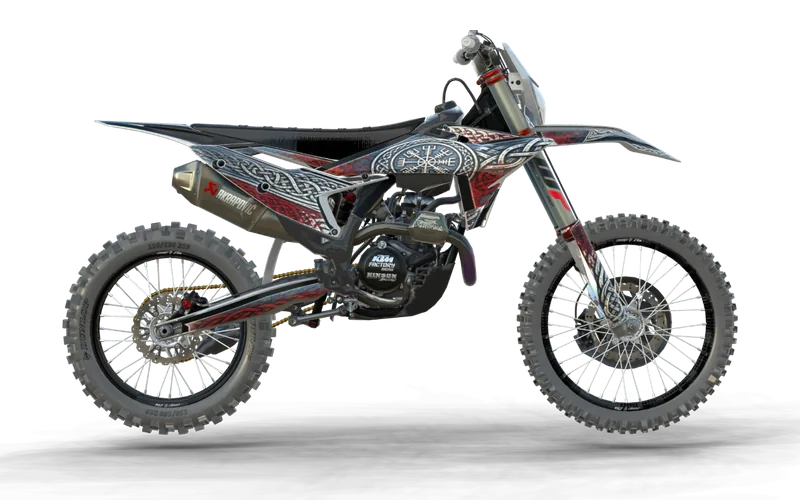 KTM 450 EXC-F | 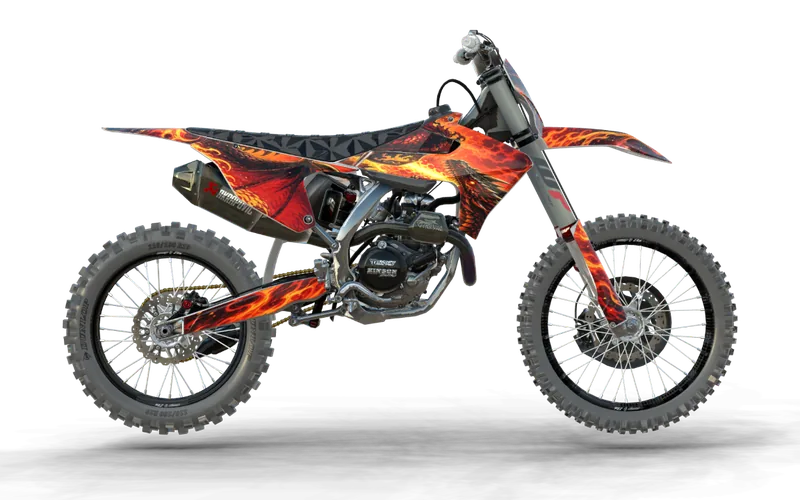 Triumph TF 450 | 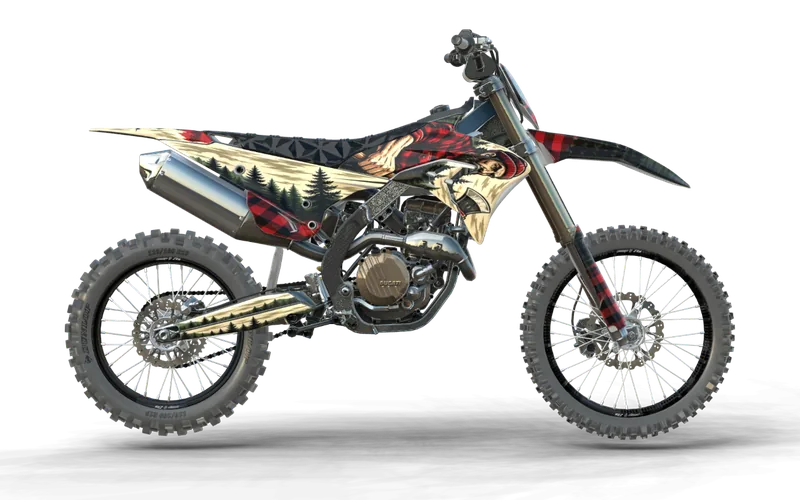 Ducati Desmo 450 MX | 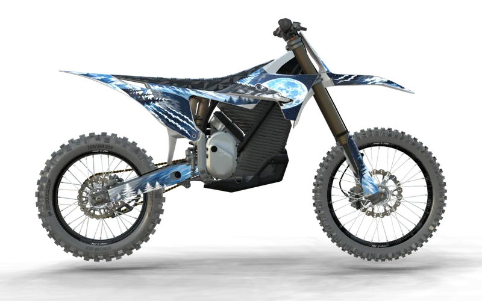 Stark Varg MX |

## Dateien

| Datei | Inhalt |
|---|---|
| [FITMENT.md](FITMENT.md) | Ein Referenz-Bike pro Zeile, mit allen Modellen und Jahrgängen, die dieselben Plastikteile haben |
| [fitment.json](fitment.json) | Dieselben Daten als JSON |

## So liest du die Tabelle

Honda-Zeile: Ein Kit für die CRF450R von 2025 passt auch auf CRF450R und CRF250R der Jahrgänge 2025 bis 2026.

Nicht abgedeckt: Zubehör-Plastikteile (Acerbis, Polisport, UFO), die meist, aber nicht immer der Serienform folgen, sowie kleine Änderungen während eines Modelljahres.

## Mitmachen

Frei nutzbar. Fehler oder fehlende Passform gefunden? Eröffne ein Issue mit Modell, Jahrgängen und deiner Quelle.

## Verwandtes

- Datenquelle: [Custom Dirt Bike Graphics](https://customdirtbikegraphics.com), ein KI-Generator für Motocross Dekor: beschreib dein Wunschdesign, bekomm ein komplettes Kit für dein Bike und bearbeite es online
- Erweiterung für die Vorschau der Startnummerntafel:  [Chrome](https://chromewebstore.google.com/detail/custom-dirt-bike-graphics/dbcfplcaolkdnoomliohiaihbjhjfapf) |  [Firefox](https://addons.mozilla.org/en-US/firefox/addon/dirt-bike-number-plate-preview/) |  [Edge](https://microsoftedge.microsoft.com/addons/detail/dirt-bike-number-plate-pr/bpaecpfcclleabbgfnkljclppkpmebkk)

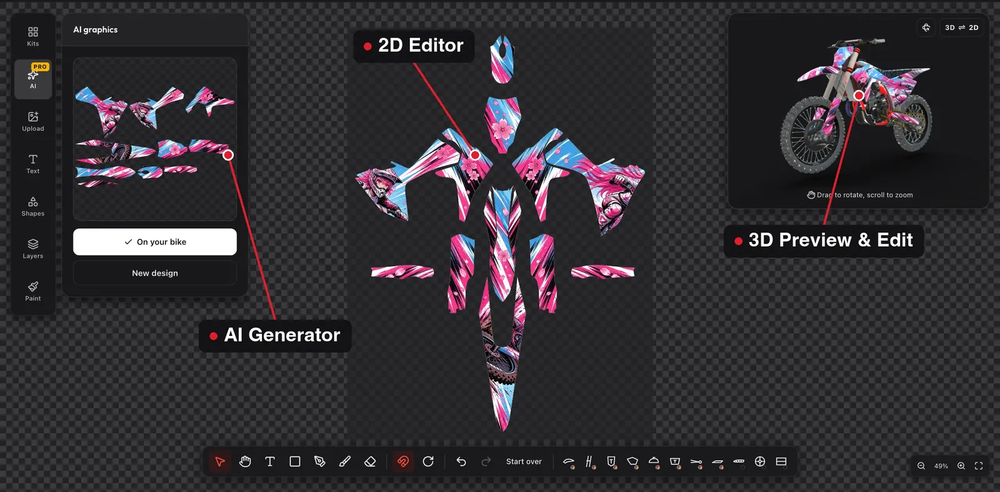

Beschreiben, die KI erstellt das Kit, dann online bearbeiten. Custom Dirt Bike Graphics, die Quelle dieser Passformdaten.

## Anderswo

**Pakete:** [npm](https://www.npmjs.com/package/dirt-bike-graphics-fitment) | [PyPI](https://pypi.org/project/dirt-bike-graphics-fitment/) | [Crates.io](https://crates.io/crates/dirt-bike-graphics-fitment) | [Docs.rs](https://docs.rs/dirt-bike-graphics-fitment) | [Go Packages](https://pkg.go.dev/github.com/dirt-bike-graphics/dirt-bike-graphics.github.io) | [Packagist](https://packagist.org/packages/custom-graphics/dirt-bike-graphics-fitment) | [JSR](https://jsr.io/@custom-graphics/dirt-bike-graphics-fitment) | [Docker Hub](https://hub.docker.com/r/jaxonzhou/dirt-bike-graphics-fitment) | [VS Code](https://marketplace.visualstudio.com/items?itemName=custom-graphics.dirt-bike-graphics-fitment) | [Open VSX](https://open-vsx.org/extension/custom-graphics-ref/dirt-bike-graphics-fitment)

**Einträge:** [There's An AI For That](https://theresanaiforthat.com/ai/custom-dirt-bike-graphics/) | [SaaSHub](https://www.saashub.com/custom-dirt-bike-graphics) | [Trustpilot](https://www.trustpilot.com/review/customdirtbikegraphics.com) | [Product Hunt](https://www.producthunt.com/products/custom-dirt-bike-graphics-ai) | [Toolify](https://www.toolify.ai/tool/custom-dirt-bike-graphics-ai) | [Hugging Face](https://huggingface.co/customdirtbikegraphics) | [Dang.ai](https://dang.ai/tool/custom-dirt-bike-graphics-ai-ai-dirt-bike-graphics-generator) | [VibeCafe](https://vibecafe.ai/products/cmv6bywru000006qg9hy27s2f) | [Pinterest](https://www.pinterest.com/customdirtbikegraphics/) | [Hashnode](https://hashnode.com/@custombikegraphics) | [SideProjectors](https://www.sideprojectors.com/user/profile/279916/projects) | [Experiment](https://experiment.com/users/cdirtbikegraphics) | [Fazier](https://fazier.com/company/customdirtbikegraphics) | [The Hack Stack](https://thehackstack.com/s/customdirtbikegraphics/) | [Indie Hacker Stacks](https://indiehackerstacks.com/products/custom-dirt-bike-graphics) | [Linktree](https://linktr.ee/customdirtbikegraphics)

**Anleitungen:** [Doku auf GitBook](https://customdirtbikegraphics.gitbook.io/custom-dirt-bike-graphics) | [Dirt Bike Dekor beschreiben](https://customdirtbikegraphics.substack.com/p/how-to-describe-dirt-bike-graphics) | [Startnummerntafel-Dekor (Folien)](https://slides.com/customdirtbikegraphics/dirt-bike-number-plate-graphics) | [Farben für das Kit wählen](https://customdirtbikegraphics.pointblog.net/picking-colors-for-a-dirt-bike-graphics-kit-that-still-look-good-at-the-track-98433479) | [Gut lesbare Startnummern](https://customdirtbikegraphics.blogdigy.com/how-to-make-your-race-number-easy-to-read-on-dirt-bike-number-plates-71623286) | [Ein Kit skizzieren](https://lessons.drawspace.com/post/1201351/sketching-a-dirt-bike-graphics-kit-before-you-de) | [Doku auf Mintlify](https://custom-dirt-bike-graphics.mintlify.app/) | [Passform als Datensatz](https://dev.to/customdirtbikegraphics/one-graphics-kit-eleven-bikes-storing-dirt-bike-fitment-as-data-3a9j)

**Demos:** [Hugging Face Space](https://huggingface.co/spaces/customdirtbikegraphics/ai-dirt-bike-graphics) | [3D-Builder auf Google Sites](https://sites.google.com/view/3d-dirt-bike-builder) | [Lovable-Version](https://dirt-bike-graphics-designer.lovable.app/) | [MiniMax-Demo](https://345ldffc5phc5.space.minimax.io/)
