# モトクロスデカール: 車種別の適合表

[English](README.md) | [Deutsch](README.de.md) | [Français](README.fr.md) | [Italiano](README.it.md) | [Polski](README.pl.md) | [日本語](README.ja.md)

同じ外装プラスチックを共有し、同じデカールキットを貼れるオフロードバイクの一覧です。11ブランド・76車種の計175年式を、17台の基準車種ごとにまとめています。対象はモトクロス、エンデューロ、電動モデルです。

| | | | |
|:---:|:---:|:---:|:---:|
| 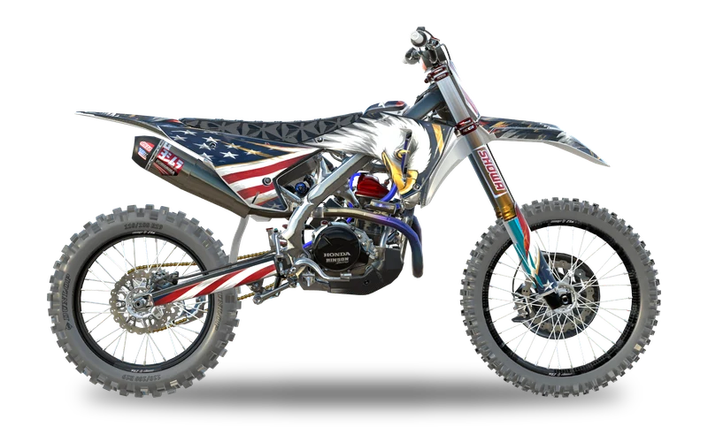 Honda CRF450R | 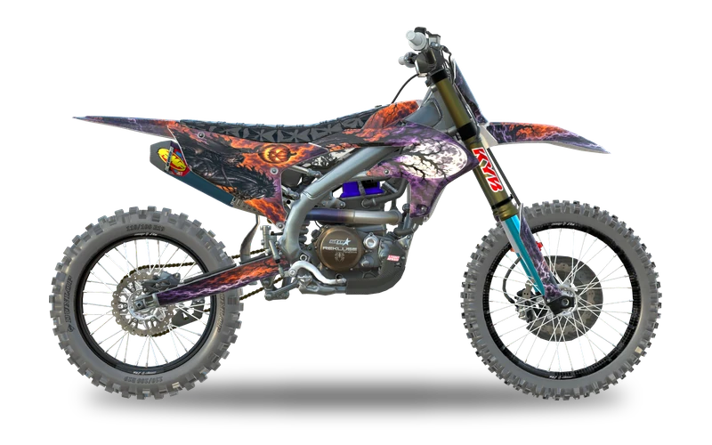 Yamaha YZ450F | 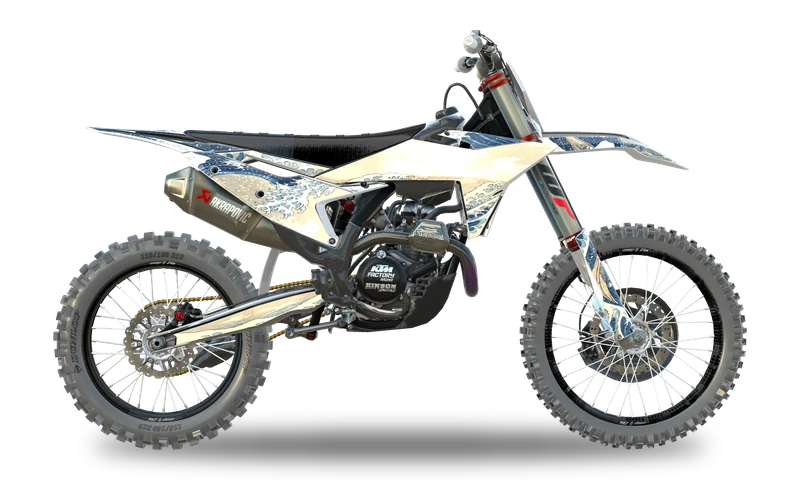 KTM 450 SX-F | 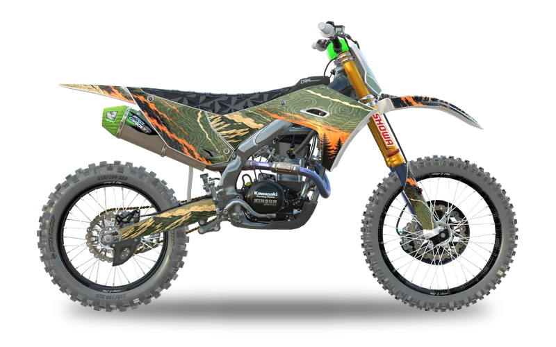 Kawasaki KX450 |
| 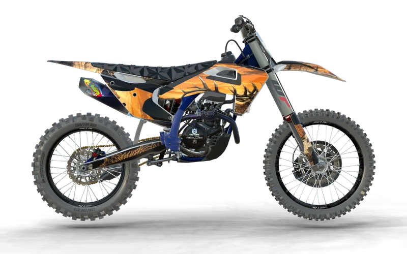 Husqvarna FC 450 | 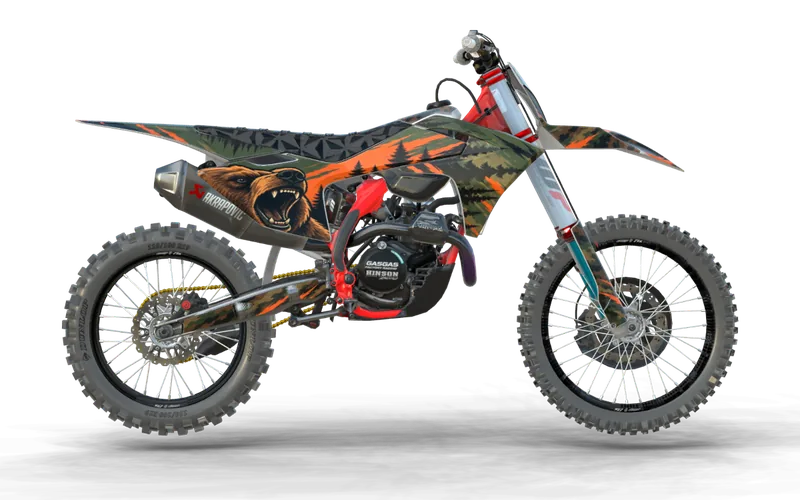 GasGas MC 450F | 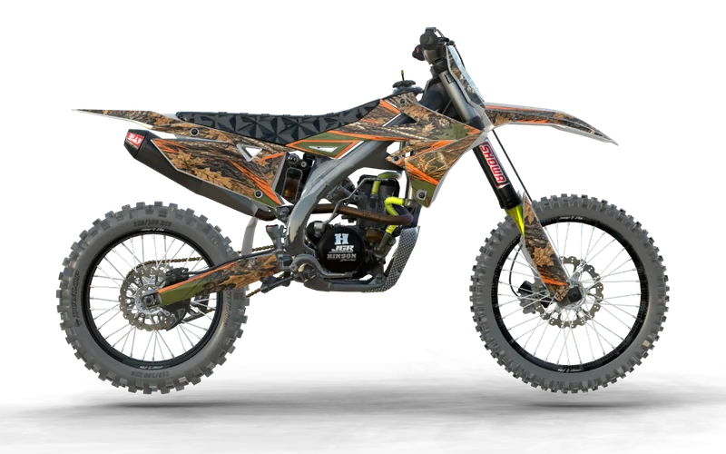 Suzuki RM-Z450 | 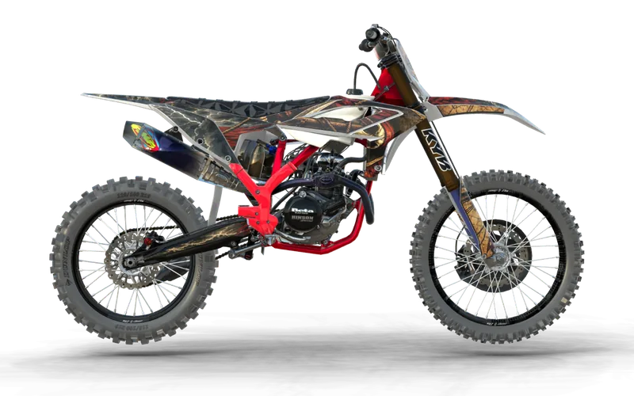 Beta 450 RX |
| 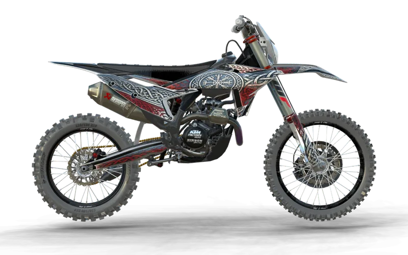 KTM 450 EXC-F | 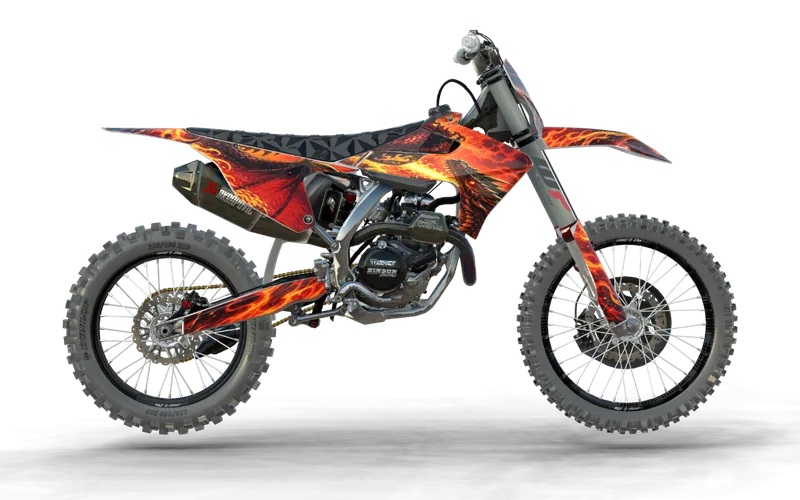 Triumph TF 450 | 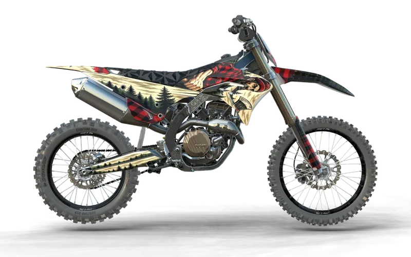 Ducati Desmo 450 MX | 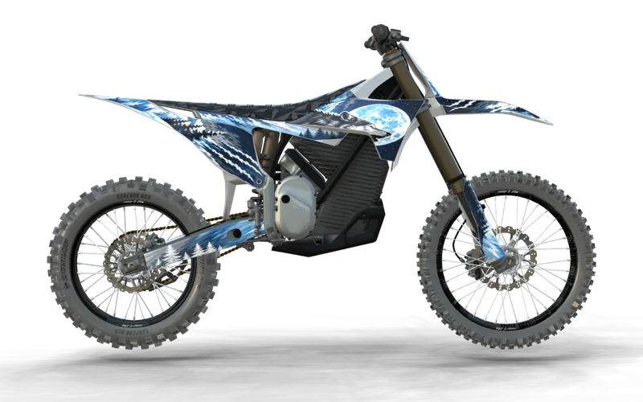 Stark Varg MX |

## ファイル

| ファイル | 内容 |
|---|---|
| [FITMENT.md](FITMENT.md) | 1行に基準車種を1台ずつ載せ、同じ外装を共有するすべての車種と年式を並べています |
| [fitment.json](fitment.json) | 同じデータのJSON版です |

## 表の見方

Hondaの行: 2025年式CRF450R用のキットは、2025年から2026年のCRF450RとCRF250Rにも合います。

対象外: 社外外装(Acerbis、Polisport、UFO)は純正形状に沿っていることが多いものの、必ずではありません。年式途中の小さな変更も含みません。

## コントリビュート

自由に使えます。誤りや抜けている適合を見つけたら、車種、年式、情報源を添えてIssueを立ててください。

## 関連

- データ元: [Custom Dirt Bike Graphics](https://customdirtbikegraphics.com)。AIでモトクロスデカールを作るジェネレーターです。欲しいデザインを伝えると、AIが車種に合ったデカール一式を生成し、そのままオンラインで編集できます
- ゼッケンプレートのプレビュー拡張機能:  [Chrome](https://chromewebstore.google.com/detail/custom-dirt-bike-graphics/dbcfplcaolkdnoomliohiaihbjhjfapf) |  [Firefox](https://addons.mozilla.org/en-US/firefox/addon/dirt-bike-number-plate-preview/) |  [Edge](https://microsoftedge.microsoft.com/addons/detail/dirt-bike-number-plate-pr/bpaecpfcclleabbgfnkljclppkpmebkk)

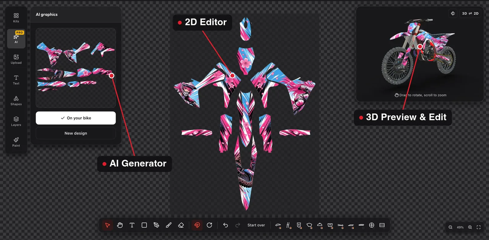

伝えるだけでAIがデカール一式を生成し、オンラインで編集できます。この適合データの出典 Custom Dirt Bike Graphics。

## その他の場所

**掲載先:** [There's An AI For That](https://theresanaiforthat.com/ai/custom-dirt-bike-graphics/) | [SaaSHub](https://www.saashub.com/custom-dirt-bike-graphics) | [Trustpilot](https://www.trustpilot.com/review/customdirtbikegraphics.com) | [Product Hunt](https://www.producthunt.com/products/custom-dirt-bike-graphics-ai) | [Toolify](https://www.toolify.ai/tool/custom-dirt-bike-graphics-ai) | [Hugging Face](https://huggingface.co/customdirtbikegraphics) | [Dang.ai](https://dang.ai/tool/custom-dirt-bike-graphics-ai-ai-dirt-bike-graphics-generator) | [VibeCafe](https://vibecafe.ai/products/cmv6bywru000006qg9hy27s2f) | [Pinterest](https://www.pinterest.com/customdirtbikegraphics/) | [Hashnode](https://hashnode.com/@custombikegraphics) | [SideProjectors](https://www.sideprojectors.com/user/profile/279916/projects) | [Experiment](https://experiment.com/users/cdirtbikegraphics) | [Linktree](https://linktr.ee/customdirtbikegraphics)

**ガイド:** [GitBookのドキュメント](https://customdirtbikegraphics.gitbook.io/custom-dirt-bike-graphics) | [モトクロスデカールの伝え方](https://customdirtbikegraphics.substack.com/p/how-to-describe-dirt-bike-graphics) | [ゼッケンプレートのデカール(スライド)](https://slides.com/customdirtbikegraphics/dirt-bike-number-plate-graphics) | [キットの配色選び](https://customdirtbikegraphics.pointblog.net/picking-colors-for-a-dirt-bike-graphics-kit-that-still-look-good-at-the-track-98433479) | [読みやすいゼッケン番号](https://customdirtbikegraphics.blogdigy.com/how-to-make-your-race-number-easy-to-read-on-dirt-bike-number-plates-71623286) | [キットのラフスケッチ](https://lessons.drawspace.com/post/1201351/sketching-a-dirt-bike-graphics-kit-before-you-de)

**デモ:** [Hugging Face Space](https://huggingface.co/spaces/customdirtbikegraphics/ai-dirt-bike-graphics) | [Google Sitesの3Dビルダー](https://sites.google.com/view/3d-dirt-bike-builder) | [Lovable版](https://dirt-bike-graphics-designer.lovable.app/) | [MiniMaxデモ](https://345ldffc5phc5.space.minimax.io/)
